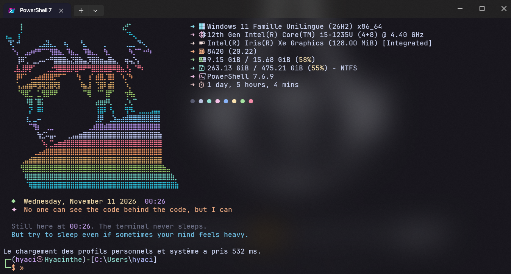
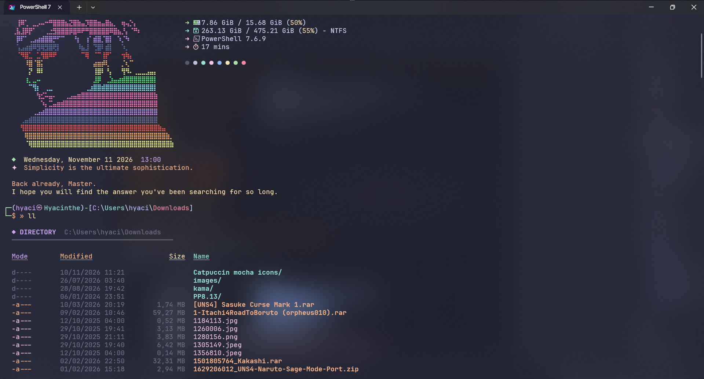
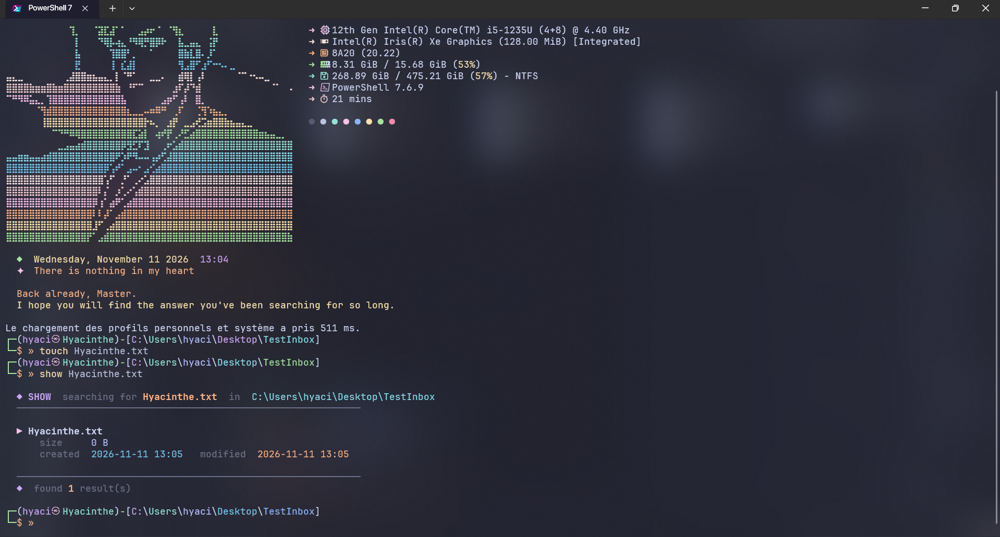
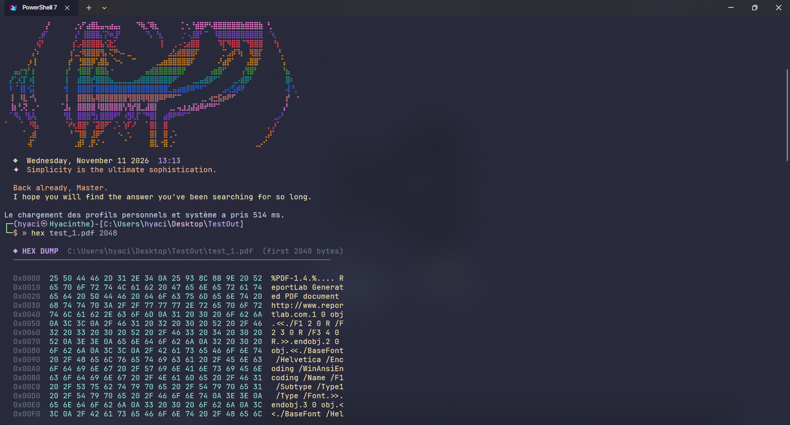
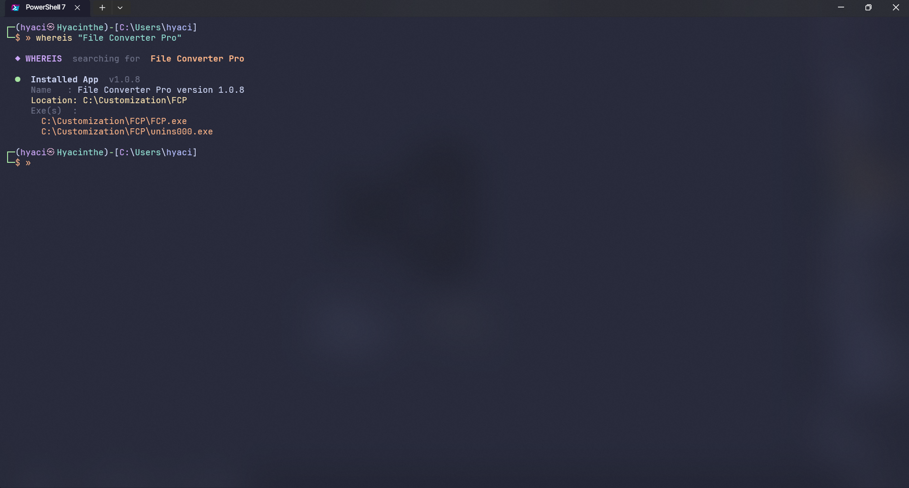

<div align="center">

<h1>ChromaShell</h1>

**A Linux-inspired PowerShell setup for Windows, themed with [Catppuccin Mocha](https://github.com/catppuccin/catppuccin), powered by [fastfetch](https://github.com/fastfetch-cli/fastfetch), with a Kali-style prompt and random ASCII art on every launch.**

[](https://github.com/PowerShell/PowerShell)
[](https://github.com/microsoft/terminal)
[](https://github.com/catppuccin/catppuccin)
[](https://www.microsoft.com/windows)
[](LICENSE)

[Preview](#preview) | [Install](#installation) | [Commands](#built-in-commands) | [Customize](#customization) | [Troubleshoot](#troubleshooting)

</div>

---

## Features

- **Catppuccin Mocha everywhere**: welcome banner, prompt, command output and terminal color scheme.
- **Kali-style two-line prompt**: user, hostname, a rainbow path, the current Git branch (yellow when the tree is dirty), an admin marker (`#` in red) and a virtualenv tag.
- **Welcome message**: date, time and a random quote at every interactive startup.
- **Random ASCII art**: fastfetch shows a random character and a random color palette on each launch (8 palettes: Catppuccin Mocha, Catppuccin Latte, Dracula, Nord, Tokyo Night, Gruvbox, Everforest, Rose Pine).
- **16 built-in commands**: file search, a local web server, process and environment inspection, Base64, clipboard helpers, weather, hashing, hex dumps and more (see the [command reference](#built-in-commands)).
- **Modular by design**: a small profile loader imports one module per concern, so each command lives in a file that is easy to find and edit.
- **One setup for both shells**: the same files work in Windows PowerShell 5.1 and PowerShell 7. Every script is pure ASCII, so no encoding tweaks are needed.
- **No external PowerShell modules required**: the commands ship with the project; only fastfetch and a Nerd Font are needed.

---

## Preview



<details>
<summary>More screenshots</summary>

<br/>






</details>

---

## How it works

```
Windows Terminal (settings.json: Catppuccin Mocha scheme + Nerd Font)
        |
        v
PowerShell profile loader (console setup, startup sequence, reload)
        |
        +-- Modules/PoshKit.Welcome   date, time, random quote
        +-- Modules/PoshKit.Shell     prompt, bookmarks, env, clip, paste, help
        +-- Modules/PoshKit.Files     ll, touch, show, hex
        +-- Modules/PoshKit.System    proc, serve, weather
        +-- Modules/PoshKit.Tools     whereis, hash, b64
        |
        v
fastfetch-random.ps1
        |-- picks a random ASCII art file from ~/.config/fastfetch/ascii/
        |-- picks a random color palette from 8 built-in palettes
        '-- runs fastfetch with the base config.jsonc and both choices
```

Everything runs locally at shell startup. There are no background processes and no telemetry. `weather` and `ip`-style lookups (if you add them) make network calls only when you run them; `serve` listens only while you keep it running.

The banner and fastfetch only run in an interactive console. They are skipped when the output is redirected (for example `pwsh -Command ...` called from a script), so they never pollute captured output.

---

## Repository layout

| Path | Purpose |
|------|---------|
| `profile/Microsoft.PowerShell_profile.ps1` | Profile loader (works in Windows PowerShell 5.1 and PowerShell 7) |
| `profile/Modules/PoshKit.Welcome/` | Startup banner and quote list |
| `profile/Modules/PoshKit.Shell/` | Prompt, navigation, bookmarks, environment, clipboard, help |
| `profile/Modules/PoshKit.Files/` | File listing, search, creation and hex dump |
| `profile/Modules/PoshKit.System/` | Processes, HTTP file server and weather |
| `profile/Modules/PoshKit.Tools/` | Command lookup, hashing and Base64 |
| `fastfetch/config.jsonc` | Base fastfetch configuration (modules, padding, colors) |
| `fastfetch/fastfetch-random.ps1` | Launcher that picks a random logo and palette |
| `fastfetch/ascii/` | 24 ASCII art `.txt` files |
| `windows-terminal/settings.json` | Ready-to-use Windows Terminal settings |
| `install.ps1` | Installer (backs up existing files, supports `-WhatIf`) |
| `.github/` | CI that checks syntax, encoding and JSON validity |

---

## Requirements

| Tool | Required | Notes |
|------|----------|-------|
| [PowerShell 7](https://github.com/PowerShell/PowerShell) or Windows PowerShell 5.1 | Yes | One setup covers both |
| [Nerd Font](https://www.nerdfonts.com/) | Yes | JetBrainsMono Nerd Font recommended |
| [fastfetch](https://github.com/fastfetch-cli/fastfetch) | Yes | System info panel |
| [Windows Terminal](https://github.com/microsoft/terminal) | Recommended | Use the included `settings.json` |
| [Git](https://git-scm.com/) | Optional | The prompt shows the branch when you are inside a repository |

---

## Installation

### 1. Install a Nerd Font and fastfetch

```powershell
winget install -e --id DEVCOM.JetBrainsMonoNerdFont
winget install fastfetch
```

fastfetch is also available through `scoop install fastfetch`, `choco install fastfetch`, or the [releases page](https://github.com/fastfetch-cli/fastfetch/releases).

### 2. Get the repository

Clone it, or download it with **Code > Download ZIP** and extract it.

### 3. Run the installer

From the repository folder, run it in **each shell you use** (Windows PowerShell and PowerShell 7 each have their own profile and module folder):

```powershell
# Windows PowerShell 5.1
powershell -ExecutionPolicy Bypass -File .\install.ps1

# PowerShell 7
pwsh -ExecutionPolicy Bypass -File .\install.ps1
```

The installer:

- copies the profile loader to the path stored in `$PROFILE` (this respects OneDrive-redirected Documents folders),
- copies the `PoshKit.*` modules into the `Modules` folder that sits next to the profile (`$PROFILE`'s parent folder), which is exactly where the loader looks for them,
- copies the fastfetch config, launcher and ASCII art to `~/.config/fastfetch/`,
- backs up any existing file that differs as `<name>.bak-<timestamp>` and never deletes anything,
- unblocks the copied files so `RemoteSigned` accepts them.

Preview what it would do without changing anything:

```powershell
pwsh -ExecutionPolicy Bypass -File .\install.ps1 -WhatIf
```

### 4. Apply the Windows Terminal settings

The included `settings.json` provides the Catppuccin Mocha scheme, acrylic transparency and the correct font. The installer can apply it for you (a backup is created first):

```powershell
pwsh -ExecutionPolicy Bypass -File .\install.ps1 -IncludeTerminalSettings
```

Or do it manually: open **Windows Terminal > Settings > Open JSON file**, replace the content with [`windows-terminal/settings.json`](windows-terminal/settings.json) and save.

> [!NOTE]
> The included settings use Windows PowerShell as the default profile. If you prefer PowerShell 7, change it under **Settings > Startup > Default profile**.

### 5. Restart your terminal

You should see the ASCII art, the welcome message and the two-line prompt. Type `help` to list every custom command.

### Manual installation

If you prefer not to use the installer:

1. Run `$PROFILE` to see where your profile must live, create it with `New-Item -Path $PROFILE -Type File -Force`, and copy `profile/Microsoft.PowerShell_profile.ps1` over it.
2. Copy the whole `profile/Modules/` folder next to the profile, so that `PoshKit.Shell` lives at `(Split-Path $PROFILE)\Modules\PoshKit.Shell\PoshKit.Shell.psm1`. Repeat for every module.
3. Create `~/.config/fastfetch/` (that is, `C:\Users\<you>\.config\fastfetch\`) and copy `fastfetch/config.jsonc` and `fastfetch/fastfetch-random.ps1` into it.
4. Copy the `fastfetch/ascii/` folder into `~/.config/fastfetch/ascii/`.

### Upgrading from an earlier version

Earlier versions shipped one large profile and kept the `.txt` art files directly in `~/.config/fastfetch/`. Run the installer again: it replaces the profile with the loader, adds the `Modules` folder and moves the art into `ascii/`. Then delete the leftovers: `fastfetch-random-ps5.ps1` and the loose `.txt` files in `~/.config/fastfetch/`.

If you already have custom modules with the same `PoshKit.*` names, the installer backs them up as `.bak-<timestamp>` before replacing them.

Bookmarks now live in `~/.config/<username>/bookmarks.json`. If you used an earlier version, move your existing `bookmarks.json` into that folder once.

---

## Built-in commands

Run `help` anytime, or filter with `help <keyword>`. If the keyword matches no custom command, `help` falls back to the standard `Get-Help`.

| Command | Category | Description |
|---------|----------|-------------|
| `ll` | Nav & Files | Detailed listing, including hidden files |
| `touch` | Nav & Files | Create empty files or update their timestamp |
| `mkcd` | Nav & Files | Create a directory and move into it |
| `show` | Nav & Files | File search with size and dates |
| `cdh` | Nav & Files | Directory bookmarks (save, jump, delete) |
| `hex` | Nav & Files | Hex dump of any file |
| `serve` | Nav & Files | Quick HTTP file server for the current folder |
| `proc` | System | Top processes by CPU or memory |
| `env` | System | List or search environment variables |
| `whereis` | Tools | Locate commands and installed apps (registry) |
| `hash` | Tools | SHA256, MD5 or SHA1, copied to the clipboard |
| `b64` | Tools | Base64 encode or decode strings and files |
| `clip` | Tools | Pipe output to the clipboard |
| `paste` | Tools | Paste clipboard text into a file |
| `weather` | Tools | Current weather and 3-day forecast ([Open-Meteo](https://open-meteo.com)) |
| `help` | Tools | This reference, filterable by keyword |

### `show`: search files

```powershell
show main.py                    # exact file name in the current folder
show main                       # every name containing "main"
show .ps1                       # every .ps1 file in the current folder tree
show -u report.pdf              # search your whole user folder
show -deep ntdll.dll            # search the whole system drive (slow)
show -from "D:\Projects" src    # search from a specific folder
```

A name that contains a dot is matched exactly (wildcards `*` and `?` are allowed). A name without a dot is matched as a substring. Each result shows its size, creation date and last modification date.

### `serve`: local HTTP server

```powershell
serve             # serve the current folder on http://localhost:8080/
serve 3000        # use another port
```

Directory listings and common file types (HTML, CSS, JS, JSON, images, PDF, video, fonts, text) are served with the right content type. Path traversal outside the served folder is blocked, and request errors are logged without stopping the server. Press `Ctrl+C` to stop it.

### `proc`: process monitor

```powershell
proc              # top 10 by CPU
proc 20           # top 20 by CPU
proc -ram         # top 10 by memory
proc 15 -ram      # top 15 by memory
```

CPU usage is sampled over 700 ms. On Windows PowerShell 5.1 the command falls back to the WMI performance counters, because that edition does not expose `Process.CPU`.

### `env`: environment variables

```powershell
env               # every variable, sorted by name
env PATH          # only names containing "PATH"
env JAVA          # only names containing "JAVA"
```

Long values are truncated to keep the table readable.

### `b64`: Base64 encode and decode

```powershell
b64 "hello world"                 # encode a string
b64 -d "aGVsbG8gd29ybGQ="         # decode a string
b64 .\payload.bin                 # encode a file (path detected automatically)
b64 -d .\payload.b64              # decode a file
b64 .\payload.bin -Out x.b64      # write the result to a file
b64 -d .\payload.b64 -Out x.bin   # decode binary data to a file
b64 -String "some-file-name"      # force string mode when a file with that name exists
```

Results are copied to the clipboard. Very long values are truncated on screen; use `-Out` to save the full result.

### `clip` and `paste`: bridge the clipboard

```powershell
Get-Content log.txt | clip        # copy text to the clipboard
Get-Process | clip                # copy any pipeline output

paste                             # print the clipboard
paste notes.txt                   # append the clipboard to a file
paste notes.txt -Overwrite        # replace the file content
```

### `whereis`: find commands and apps

```powershell
whereis git                    # resolves commands (PATH, cmdlets, functions, aliases)
whereis "Visual Studio Code"   # finds installed apps through the registry
```

Searches the HKLM and HKCU uninstall keys (32-bit and 64-bit views) and lists the `.exe` files found in the install location.

### `cdh`: directory bookmarks

```powershell
cdh                  # list bookmarks
cdh save             # bookmark the current folder (named after the folder)
cdh save myproject   # bookmark with a custom label
cdh myproject        # jump to it later
cdh del myproject    # remove a bookmark
```

Bookmarks are stored in `~/.config/<username>/bookmarks.json`, where `<username>` is your Windows user name. The labels `save` and `del` are reserved.

### `weather`: forecast in the terminal

```powershell
weather          # default city (see Customization)
weather Tokyo    # any city worldwide
```

Shows current conditions (temperature, feels-like, humidity, wind, visibility) and a 3-day forecast.

### `hash` and `hex`: inspect files

```powershell
hash app.exe            # SHA256 (default), copied to the clipboard
hash app.exe -md5       # MD5 instead
hash -text "hello"      # hash a raw string

hex payload.bin         # first 256 bytes as hex and ASCII
hex payload.bin 512     # first 512 bytes
```

`hex` reads only the requested bytes, so it is safe on very large files.

---

## Customization

| What | Where | How |
|------|-------|-----|
| Prompt layout, colors, Git branch, admin marker | `profile/Modules/PoshKit.Shell/PoshKit.Shell.psm1` | Edit `prompt` and `$script:Theme` |
| Prompt path colors | `$palette` inside `prompt` | Add or reorder the 9 Catppuccin colors |
| Welcome quotes | `profile/Modules/PoshKit.Welcome/PoshKit.Welcome.psm1` | Add or remove entries in `$script:Quotes` |
| Default weather city | `profile/Modules/PoshKit.System/PoshKit.System.psm1` | Edit `$script:Settings.WeatherCity` |
| Bookmark file | `profile/Modules/PoshKit.Shell/PoshKit.Shell.psm1` | Edit `$script:Settings.BookmarkFile` |
| ASCII art | `~/.config/fastfetch/ascii/*.txt` | Drop in your own `.txt` files; one is picked at random per launch |
| Color palettes | `$palettes` in `fastfetch-random.ps1` | Add a palette with 9 hex colors |
| Fixed logo or palette | The `& $fastfetchScript` call in the profile | Append `-Art itachi -Palette nord` |
| Boxed title | `New-BoxedTitleConfig` in `fastfetch-random.ps1` | The launcher swaps the `title` module for a rounded box at launch, using the title colors from `config.jsonc`; if that fails, the plain title is shown |
| `fastfetch` command | `function fastfetch` in the profile | Runs your launcher with no arguments (or `-Art` / `-Palette`); any other option goes to the real `fastfetch.exe` |
| Transparency and font | `settings.json` | Edit `opacity`, `font.face`, `font.size` |

Your user name is highlighted in the prompt automatically through `$env:USERNAME`. Nothing is hard-coded.

ASCII art files use the color slots `$1` to `$9`; each slot is replaced by the matching color of the active palette.

---

## Troubleshooting

<details>
<summary><b>"running scripts is disabled on this system"</b></summary>

This is the Windows execution policy. Run once:

```powershell
Set-ExecutionPolicy -Scope CurrentUser RemoteSigned
Unblock-File $PROFILE
Unblock-File "$HOME\.config\fastfetch\fastfetch-random.ps1"
```

Then reopen the terminal. The installer already unblocks the files it copies.
</details>

<details>
<summary><b>The profile does not load</b></summary>

Run `$PROFILE` in the shell you use and check that the file exists at exactly that path. Your Documents folder may be redirected to OneDrive, in which case the path is not `C:\Users\<you>\Documents\...`. The installer always uses the correct path.
</details>

<details>
<summary><b>"Profile: module failed to load: ..."</b></summary>

The loader could not find or import one of the `PoshKit.*` modules. Check that a `Modules` folder sits next to your profile and contains `PoshKit.Shell\PoshKit.Shell.psm1`, `PoshKit.Files\PoshKit.Files.psm1`, `PoshKit.System\PoshKit.System.psm1`, `PoshKit.Tools\PoshKit.Tools.psm1` and `PoshKit.Welcome\PoshKit.Welcome.psm1`. Re-run the installer if a folder is missing, then type `reload`.
</details>

<details>
<summary><b>Icons render as boxes or question marks</b></summary>

Make sure Windows Terminal uses a Nerd Font: check `"face": "JetBrainsMono Nerd Font Mono"` under `profiles.defaults.font` in the Terminal settings JSON. The prompt also uses `㉿` and box-drawing characters; UTF-8 output is configured by the profile.
</details>

<details>
<summary><b>No system info on startup</b></summary>

fastfetch may not be in your `PATH`. Test with `fastfetch --version`. If it fails, reinstall it with `winget install fastfetch` and reopen the terminal.
</details>

<details>
<summary><b>`serve` says the server could not start</b></summary>

The port is already in use or blocked. Try another port (`serve 3000`). If the message mentions access rights, use a port above 1024 and run the shell as your normal user.
</details>

<details>
<summary><b>I need a clean shell without the profile</b></summary>

Start it with `pwsh -NoProfile` (or `powershell -NoProfile`).
</details>

---

## Uninstall

1. Delete the profile file shown by `$PROFILE` (or restore the `.bak-<timestamp>` backup next to it).
2. Delete the `PoshKit.*` folders under `(Split-Path $PROFILE)\Modules\` if you installed them from this repository.
3. Delete `~/.config/fastfetch/` if you do not use fastfetch for anything else.
4. Delete `~/.config/<username>/` to remove your bookmarks.

---

## Development

CI runs `.github/scripts/validate.ps1` on Windows PowerShell 5.1 and PowerShell 7. It checks that every `.ps1` and `.psm1` file parses, that scripts contain only ASCII characters, that the JSON files are valid and that ASCII art files use lowercase kebab-case names. You can run the same script locally:

```powershell
./.github/scripts/validate.ps1
```

Module conventions:

- one folder per module, with a `<ModuleName>.psm1` inside,
- export commands explicitly with `Export-ModuleMember` at the bottom,
- keep the files ASCII-only; build glyphs from code points such as `[string][char]0x25C6`,
- the profile loader imports modules from `$PSScriptRoot\Modules` with `-Force`, so `reload` picks up edits.

---

## Credits

This project builds on the work of [SleepyCatHey](https://github.com/SleepyCatHey). The original concept and setup were presented in [his video](https://www.youtube.com/watch?v=z3NpVq-y6jU), which is worth watching if you want to understand the full stack or push your Windows terminal further.

Palette by [Catppuccin](https://github.com/catppuccin/catppuccin). System info by [fastfetch](https://github.com/fastfetch-cli/fastfetch).

The ASCII art depicts characters from anime and manga. It is fan art, and the characters belong to their respective owners.

## Support

If this setup made your terminal nicer, consider leaving a star or [sponsoring the project](https://github.com/sponsors/Hyacinthe-primus).

## License

Released under the [MIT License](LICENSE).
